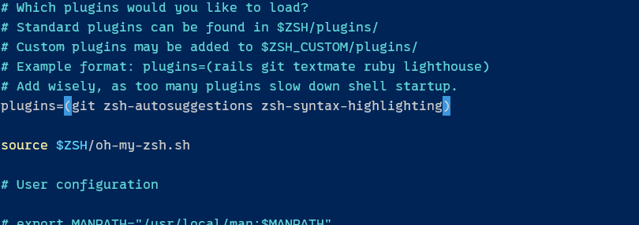
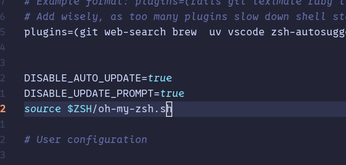
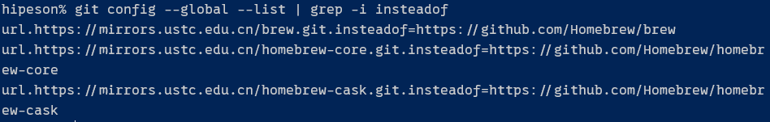

# Linux环境与软件配置

## 环境与软件列表
- SHELL : `zsh` + `Oh My Zsh` + `Starship`
- 编辑器 : `neovim` + `lazyvim`
- 包管理器：`Homebrew`
- 文件管理器：`yazi`
- 
## 环境与软件安装与配置
**Installation & Configuration**

### 1. 配置 `zsh` Shell 
使用`zsh` 配合``
Use `zsh` with `Oh My Zsh` and `Starship`

1. Install `zsh`
默认使用的是`bash`，执行
```bash
# 更新软件包apt
sudo apt update

# 安装zsh
sudo apt install zsh
```
2. 安装完成后，可以用 `zsh --version` 验证是否成功。

3. 若设置zsh为默认SHELL，执行
```bash
chsh -s $(which zsh)
```
需要先注销并重新登录（或重启终端），修改才会生效。

### 2. 安装`Oh My Zsh` 插件
1. 使用官方提供的国内加速链接,Oh My Zsh 官方考虑到了网络问题，提供了专门的国内安装入口。直接在 Zsh 里运行

```bash
sh -c "$(curl -fsSL https://gitee.com/pocmon/ohmyzsh/raw/master/tools/install.sh)"
```
2. 安装OMZ插件

- `zsh-autosuggestions` 命令自动建议和
```bash
git clone https://gitee.com/mirrors/zsh-autosuggestions.git ${ZSH_CUSTOM:-~/.oh-my-zsh/custom}/plugins/zsh-autosuggestions
```
然后再`~/.zshrc`中添加`zsh-autosuggestions`到插件列表中，如下：
```bash
plugins=(zsh-autosuggestions )
```

- `zsh-syntax-highlighting`语法高亮

```bash
git clone https://gitee.com/mirrors/zsh-syntax-highlighting.git ${ZSH_CUSTOM:-~/.oh-my-zsh/custom}/plugins/zsh-syntax-highlighting
```
同样在`~/.zshrc`中添加`zsh-syntax-highlighting`到插件列表中，如下：
```bash
plugins=(zsh-syntax-highlighting )
```
如图所示：


然后让配置生效：
```bash
source ~/.zshrc
```

如果安装了`zsh-syntax-highlighting`，会发现输入命令时非常卡，可能是由于`Oh-my-zsh`的自动更新原因。
可以在`~/.zshrc`中添加以下配置，关闭自动更新：
```bash
DISABLE_UPDATE_PROMPT=true
DISABLE_AUTO_UPDATE=true
```



### 3. 安装Homebrew `brew` 软件包管理器
1. 安装依赖包

```bash
sudo apt update
sudo apt install build-essential procps curl file git
```

若可以正常连接GitHub，则可以执行官方安装脚本，忽略之后步骤。
```bash
/bin/bash -c "$(curl -fsSL https://raw.githubusercontent.com/Homebrew/install/HEAD/install.sh)"
```

若不能，则使用中科大镜像安装，即以下步骤：

2.  配置 Zsh 的 Bottle/API 镜像（加速后续安装软件）

```bash
echo 'export HOMEBREW_API_DOMAIN="https://mirrors.tuna.tsinghua.edu.cn/homebrew-bottles/api"' >> ~/.zshrc
echo 'export HOMEBREW_BOTTLE_DOMAIN="https://mirrors.tuna.tsinghua.edu.cn/homebrew-bottles"' >> ~/.zshrc
source ~/.zshrc
```
3. 这是整个流程中最关键的一步。因为安装脚本内部会调用 `git clone/fetch`，默认走 `github.com`，国内直连几乎必然失败。通过 URL 替换，强制所有 GitHub 请求走中科大镜像。
```bash
git config --global url."https://mirrors.ustc.edu.cn/brew.git".insteadOf "https://github.com/Homebrew/brew"
git config --global url."https://mirrors.ustc.edu.cn/homebrew-core.git".insteadOf "https://github.com/Homebrew/homebrew-core"
git config --global url."https://mirrors.ustc.edu.cn/homebrew-cask.git".insteadOf "https://github.com/Homebrew/homebrew-cask"
```
4. 验证是否写入成功：
```bash
git config --global --list | grep -i insteadof
```
5. 成功将输出：
   


6. 使用中科大镜像脚本安装`brew`
```bash
/bin/bash -c "$(curl -fsSL https://mirrors.ustc.edu.cn/misc/brew-install.sh)"
```
中途按回车确认即可。脚本会自动从中科大镜像拉取 brew 核心仓库，并从清华镜像下载 portable-ruby。
 
7. 安装成功后，把 Homebrew 加入 Zsh 的 PATH：

```bash
echo 'eval "$(/home/linuxbrew/.linuxbrew/bin/brew shellenv)"' >> ~/.zshrc
source ~/.zshrc
```
8. 验证是否成功：
```bash
brew --version   # 应显示 Homebrew 版本号
brew doctor      # 应输出 "Your system is ready to brew."
```


### 4. 安装`starship`提示符
`starship`可以使shell的提示符更加美观，
从

到

安装 Starship 很简单，因为你现在已经有了 Homebrew，所以不需要用官方脚本，直接用 brew 安装会稳妥很多。

1. 用 Homebrew 安装
在终端里执行：
```bash
brew install starship
```
2. 在 Zsh 中启用
装好后，把初始化代码加到 `~/.zshrc` 文件的末尾：

```bash
echo 'eval "$(starship init zsh)"' >> ~/.zshrc
```
这行命令会让 Starship 接管你的提示符。

3. 让配置生效
运行下面的命令，或者直接新开一个终端窗口：
```bash
source ~/.zshrc
```
💡 关于 Nerd Font 字体
Starship 的很多图标需要 Nerd Font 字体才能正常显示。如果你看到一些方框或乱码，需要去 Nerd Fonts 官网https://www.nerdfonts.com/font-downloads 下载一款（比如 0xProto Nerd Font Mono），安装后在终端设置里把字体改过去就行。

✨ 可选：换个主题
如果觉得默认样式不喜欢，Starship 内置了很多预设主题。可以去Starship官网的社区配置页https://starship.rs/zh-CN/presets/ 挑选一个喜欢的。

比如我用的是`Gruvbox Rainbow Preset`,可以直接在终端输入
```bash
starship preset gruvbox-rainbow -o ~/.config/starship.toml
```
**参考资料**


### 5. 安装`neovim`编辑器
1. 使用brew安装`neovim`
```bash
brew install neovim
```
安装后就可以使用`nvim`命令打开neovim


2. 安装`lazyvim`
执行
```bash
git clone https://gitee.com/mirrors_zhaozg/nvim-starter.git ~/.config/nvim
```


**参考资料**
【自从用了Neovim 鼠标我已经扔了-哔哩哔哩】 https://b23.tv/dhpgAb9


### 6. 安装`yazi`文件管理器


